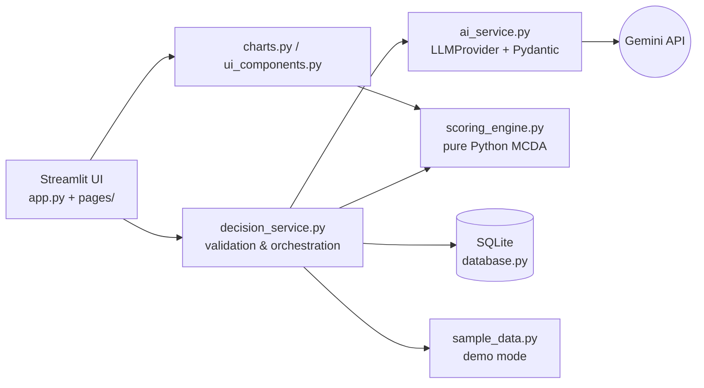

# DecisionForge AI

**An Explainable Generative AI System for Multi-Criteria Decision Analysis**

A locally runnable Streamlit application in which a Large Language Model drafts the *qualitative* analysis of a decision (alternatives, criteria, strengths, risks, trade-offs) and a separate, deterministic Python engine calculates the *quantitative* ranking. Every score can be reproduced from the displayed ratings and weights.

---

## 1. Problem statement

People and small teams regularly face decisions with several options and conflicting goals (for example, choosing a technology stack under a tight deadline and budget). Such decisions are often made informally, and the reasoning is hard to inspect, challenge or repeat.

## 2. Motivation

* Students and small teams rarely have access to formal decision-analysis tools.
* General chatbots can give persuasive advice, but it is usually not traceable to explicit criteria or weights.
* Pure spreadsheet scoring is transparent but requires the user to invent alternatives, criteria and ratings.

## 3. Objectives

1. Understand a decision problem, its constraints and priorities.
2. Identify or suggest alternatives and criteria.
3. Compare alternatives with transparent weighted scoring.
4. Explain advantages, disadvantages, risks and trade-offs.
5. Let users change priorities and see the ranking change without another AI call.
6. Save and revisit analyses.

## 4. Existing approach and its limitations

| Approach | Limitation |
|---|---|
| Informal discussion / gut feeling | Not reproducible; biased by the loudest opinion |
| Manual weighted spreadsheet | Transparent but slow; user must supply all content |
| Asking a chatbot "which is best?" | Fluent but opaque; the ranking cannot be traced to weights and may change between runs |

## 5. Proposed solution

A hybrid architecture: **GenAI for language-heavy reasoning, deterministic code for arithmetic.** The AI proposes content and raw ratings; the user can review and edit them; Python normalises, weights and ranks. The AI is never allowed to produce the final score.

## 6. What makes this implementation different

* **Separation of concerns:** the scoring engine has no dependency on Streamlit or any LLM and is covered by unit tests.
* **Reproducibility:** the displayed table, charts and ranking all come from the same function call.
* **Interactive what-if analysis:** changing weights recalculates instantly and explains the real before/after ranking (no extra API cost).
* **Honest labelling:** AI estimates, sample data and calculated values are visibly distinguished; disagreement between the AI's first suggestion and the calculated winner is surfaced rather than hidden.
* **Defensive AI handling:** Pydantic-validated JSON, reconciliation with the user's request, one bounded repair retry, and friendly error messages.

*This README makes no claims of accuracy or superiority over other tools; no evaluation or user study has been performed.*

## 7. Features

* Home, New Analysis, Analysis History and About pages with a sidebar.
* Input form with validation: title, description, 2–6 alternatives (manual or AI-suggested), constraints, 3–7 criteria (manual or AI-suggested), weights 0–10.
* Live GenAI mode (Gemini API; OpenAI is also supported) and clearly labelled **Sample demo** mode with two scenarios.
* Review step: inspect and edit AI ratings before confirming.
* Results dashboard: summary, recommendation with caveat, ranked table, score bar chart, criteria heatmap / grouped bars, weight chart, strengths/weaknesses, risks, trade-offs, assumptions and limitations.
* Weight sliders with reset, instant re-ranking and an explanation of the change.
* SQLite history: save, reopen, update weights, delete with confirmation.
* 77 automated tests (no network or API key needed).

## 8. Technology stack and rationale

| Technology | Why |
|---|---|
| Python 3.11/3.12 | Familiar, rich ecosystem |
| Streamlit | Fast, professional dashboards without a separate front-end project |
| Pandas | Tabular handling of results |
| Plotly | Interactive charts that update with weights |
| Gemini API / OpenAI SDK | Live structured analysis with Gemini (OpenAI is an optional provider) |
| Pydantic | Strict validation of LLM output and user input |
| SQLite (`sqlite3`) | Zero-setup, local persistent storage |
| pytest | Unit and UI smoke tests |
| python-dotenv | Keeps the API key out of source code |

## 9. System architecture



| File | Responsibility | Uses GenAI? |
|---|---|---|
| `scoring_engine.py` | Normalisation, weighted scores, ranking, ties, change summaries | **No** |
| `ai_service.py` | Prompts, provider interface, JSON parsing, repair retry | **Yes** |
| `models.py` | Pydantic schemas | No |
| `decision_service.py` | Validation, building analyses, deterministic explanations | No |
| `database.py` | SQLite persistence | No |
| `sample_data.py` | Predefined demo scenarios | No |
| `charts.py`, `ui_components.py`, `utils.py`, `pages/`, `app.py` | Interface | No |

## 10. Data flow

1. User fills the form → `validate_request` (Pydantic + friendly messages).
2. `DecisionAnalyzer.analyze` sends a prompt (user data passed as JSON data) → raw JSON.
3. JSON is parsed and validated; names, criteria and rating completeness are reconciled with the request. Invalid output triggers at most one repair retry.
4. `build_analysis` creates the analysis record; the user reviews/edits the raw ratings.
5. `scoring_engine.calculate_scores` computes scores and ranks.
6. The AI writes an explanation of the calculated ranking (falls back to a calculated summary if the AI fails).
7. Sliders change weights → step 5 re-runs in Python only.
8. The analysis can be saved to SQLite and reopened later.

## 11. GenAI workflow

*Call 1 (analysis):* interpret the decision; suggest alternatives/criteria if missing; produce strengths, weaknesses, raw ratings with rationales, risks, trade-offs, assumptions and an initial recommendation.
*Call 2 (explanation):* receives the **calculated** ranking and explains why the winner suits the user's priorities.
The model may not set final scores; it is told it cannot verify prices, benchmarks or current facts, and it must list assumptions. If the AI's initial recommendation differs from the calculated winner, the interface says so and asks the user to review assumptions; the ranking is never silently changed.

## 12. Weighted scoring methodology

Let `raw(i,j)` be the 1–10 rating of alternative *i* on criterion *j*.

```
r(i,j) = raw(i,j)        if criterion j is a benefit (higher is better)
r(i,j) = 11 - raw(i,j)   if criterion j is a cost (higher raw = more cost/effort/time)

Weighted Score(i) = SUM_j( w(j) * r(i,j) ) / SUM_j( w(j) )
```

Result is a weighted average between 1 and 10. Negative weights, non-numeric values, ratings outside 1–10 and all-zero weights are rejected. Ties are broken by the normalised score on the most heavily weighted criterion, then the next, then alphabetically.
**Interpretation of weights:** a higher weight means the criterion matters more; for a cost criterion it is the importance of keeping that cost low.

## 13. Database design

Table `analyses` (created automatically at start-up):

| Column | Content |
|---|---|
| `id` | Primary key |
| `title`, `description` | Decision text |
| `created_at`, `updated_at` | UTC timestamps |
| `mode`, `model` | `live` / `sample`, model name |
| `constraints_json` | Budget, time, team, other, priorities note |
| `alternatives` | JSON list with strengths, weaknesses, use cases |
| `criteria` | JSON list (name, direction, description) |
| `original_weights`, `updated_weights` | JSON |
| `ratings` | JSON raw ratings per alternative/criterion |
| `final_scores`, `rankings` | JSON from the scoring engine |
| `ai_content` | JSON: rationales, risks, trade-offs, assumptions, recommendation text |

API keys are never stored. The database file lives in `data/` (git-ignored).

## 14. Installation and configuration (Windows PowerShell)

Requires Python 3.11 or 3.12 (`py --version`).

```powershell
# 1. Open the project folder (unzip the project, then:)
cd DecisionForge-AI

# 2. Create and activate a virtual environment
py -3.12 -m venv .venv
.\.venv\Scripts\Activate.ps1
#   If activation is blocked:  Set-ExecutionPolicy -Scope Process -ExecutionPolicy Bypass

# 3. Install dependencies
python -m pip install --upgrade pip
pip install -r requirements.txt

# 4. Create your local .env file (never commit it)
Copy-Item .env.example .env
notepad .env        # replace your_openai_api_key_here with your own key, then save
```

If you skip step 4 the app still runs in **Sample demo** mode.
Add a newly generated Gemini API key to the local `.env` file as `GEMINI_API_KEY=...`; never paste it into source code or commit it. The default provider is Gemini, using Google's native `generateContent` endpoint and JSON response mode. The verified default model is `gemini-3.1-flash-lite`. Optional settings: `GEMINI_MODEL`, `AI_TIMEOUT_SECONDS`, and `DATABASE_PATH`. Restart the app after editing `.env`.

To use OpenAI instead, set `AI_PROVIDER=openai`, add `OPENAI_API_KEY`, and optionally set `OPENAI_MODEL`.

## 15. Run instructions

```powershell
streamlit run app.py
```

The app opens at <http://localhost:8501>.

## 16. Testing

```powershell
python -m pytest -q
```

Tests cover the scoring engine, database persistence, validation, AI-response handling (with a fake provider) and Streamlit page flows. No test calls the network.

## 17. Demo instructions

See [`DEMO_GUIDE.md`](DEMO_GUIDE.md) for a rehearsable 5-minute demo, the project introduction and viva questions. Quick check without an API key: **New Analysis → Sample demo → Load sample analysis → Confirm**, then move the *Scalability* and *Budget Cost* sliders.

## 18. Limitations

* AI ratings are estimates; the AI cannot verify current prices, versions or benchmarks.
* Weighted-sum MCDA assumes criteria are independent and fully compensatory.
* Different runs of the LLM may produce different ratings; edit them in the review step.
* Live mode needs internet access and a provider API key, and may incur charges.
* No authentication or multi-user support (single local user).
* Sample scenarios are illustrative data, not verified facts.
* The default model name may need updating as providers retire models.

## 19. Future enhancements

* Additional providers (Azure OpenAI, local models) via the `LLMProvider` interface.
* Sensitivity analysis showing the weight at which the winner changes.
* Alternative MCDA methods (e.g. TOPSIS, AHP) for comparison.
* Import real measured data for criteria instead of AI estimates.
* Export of reports to PDF/Word.
